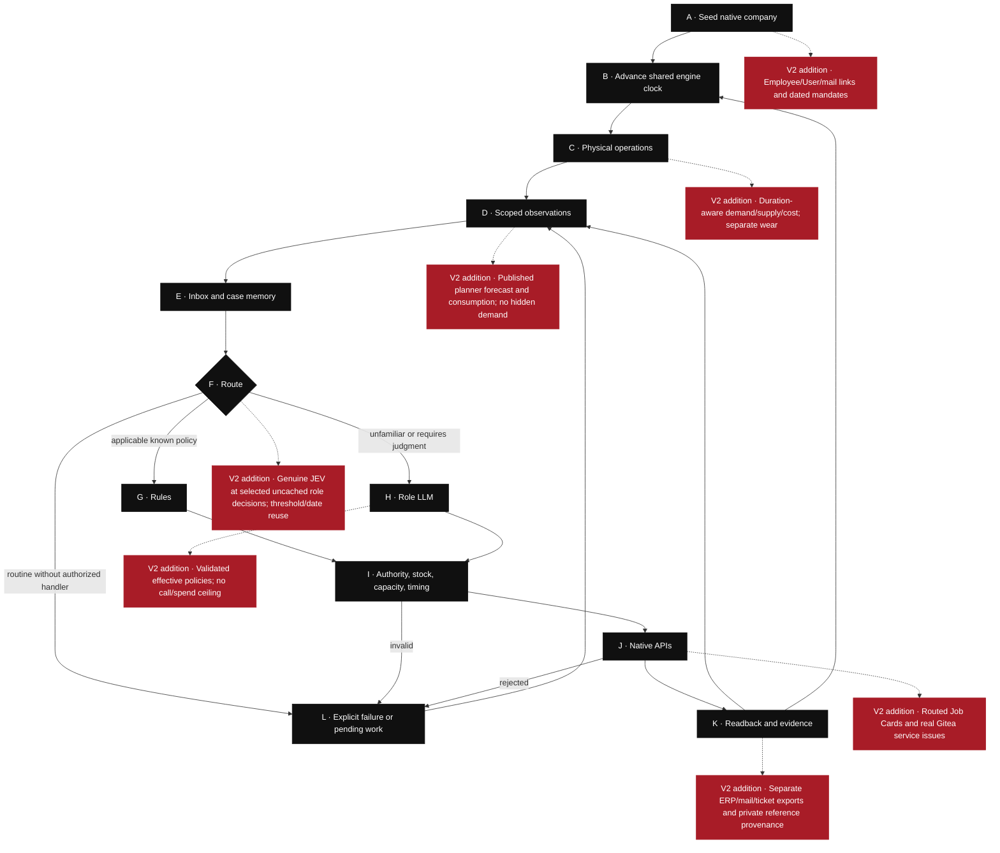

# Operating loop: the shared implementation map

This project generates company history through real applications so an extraction harness can later reconstruct how the company works. The loop below is the stable vocabulary for discussing changes. Black blocks are the original loop; red annotations identify v2 additions. It is a conceptual map, not a claim that every operation invokes JEV or an LLM.

## Locate a change in the code

| Block | Responsibility | Current implementation |
| --- | --- | --- |
| A | Company, identities, permissions, opening stock, policies | `Engine.seed`, `recurring_setup`; `systems_v2.identities` |
| B | Advance and resume one simulation clock | `recurring_events`, `step`, `_step`, `through` |
| C | External conditions and physical consequences | `regimes.factors`; `regime`, `arrivals`, `production`, `service` |
| D | Evidence the acting role can access | `observe`, `inventory`, `observed_usage`; role API clients |
| E | Previous decisions and effective policies | `choose`, `effective_policies`; persisted case history |
| F | Route a decision to rules, judgment or explicit pending work | `choose`; `router.route` |
| G | Execute an authorized routine policy | Policy branch of `choose`; routine operational methods |
| H | Model judgment and proposed policy | `decision`, `adopt_policy` |
| I | Check authority and enforce operational constraints | Action-specific checks, native roles/workflows and application validations |
| J | Perform actions and schedule physical consequences | `write`, `mapped`, `mail`; `systems_v2` Job Card and Tickets APIs |
| K | Confirm records, preserve evidence and export | API readbacks, `log`, `persist`; `verify_run.py`, `systems_v2.export_native` |
| L | Preserve pending work and explicit failure | Deferred/rejected decisions, API exceptions, resumable state |

Methods above are in `native/company.py` unless qualified. These are not twelve separate services. The actual daily sequence is service → arrivals → inspections → demand → fulfillment → production → replenishment → approvals → settlements → management. Do not create a second clock in the notebook.

## Three boundaries to preserve

1. **World versus knowledge:** external regimes and physical schedules are private. Roles see observed records, messages and forecasts; they do not receive hidden labels or future outcomes.
2. **Decision versus outcome:** approval does not mean implementation; posting an order does not mean goods arrived. Follow native records and physical consequences separately.
3. **Applications versus extraction:** ERPNext/MariaDB, Gitea/SQLite and mail files retain their own IDs. The extractor must reconcile their observable links. Private crosswalks and execution traces belong to grading, not extractor input.

The external-factor implementation currently samples persistent episodes and recovery. It is STOCKTAKE-inspired, not a fitted HMM. JEV classifies whether judgment is needed; it does not choose the business action. Routine operations can execute without consulting JEV. See the dated routing limitation in PROVENANCE.md.

## Native confirmation and routing reuse

D applies the simulated date as an additional AND predicate on dated ERP reads. An explicit equality, lower bound or existing AND-filter list remains in force. F reuses a routine classification only when the effective policy and the decision evidence match. Receipt and open-order rows and coverage rows are compared independent of their read order. Usage, quantities, dates, prices and other visible evidence are compared by value.

J records an uncertain SMTP attempt before submission and records acceptance before connection teardown. K confirms delivery by opening the full message in the intended recipient's IMAP inbox and checking identity, reference, subject and body. The pending checkpoint survives a restart. L reconciles accepted or uncertain mail through IMAP on retry and keeps it pending if delivery is still absent. A definitive SMTP rejection permits a later attempt. SMTP acceptance only confirms that the server took responsibility. A dropped reply or a process exit during submission can leave the result unknowable from the client, and an empty inbox can mean late, failed or missing delivery. An unresolved operation requires checking the mail service before an operator authorizes another submission. A stable Message-ID helps correlation, but SMTP does not guarantee deduplication.

J uses Gitea mutation responses to identify new issues and comments. K reads the issue and resolution independently and checks their reference, content, association and issue state before recording progress. A successful mutation's identity is checkpointed for retry. Recovery from a lost POST reply depends on the operation reference becoming visible in Gitea.

## Example: maintenance across systems

Production accumulates equipment use (C). A maintenance issue is opened through Gitea (J), its identifier is read back (K), and work remains pending until service completes. Mail and ERP records provide related evidence (D). The issue is closed after the modeled repair; subsequent production can resume. A ticket alone does not prove a repair occurred.

## Change contract

Every contribution should state: **affected A–L blocks → input evidence → decision/action → native records and links → check**. If a new application is added, wire its identities at A, reads at D, actions at J and readback/export at K. Keep this diagram and the focused notebook aligned. Preserve the diagram's stable labels; do not replace the company objective with a single-process demo.

## Proposed company behavior and integrations

[Company logic architecture](COMPANY-LOGIC.md) grounds the proposed MES, QMS, PLM and lakehouse integration in manufacturing workflows, record ownership, guards and failure recovery. It extends this A–L contract; it is not a claim of implemented integrations.
